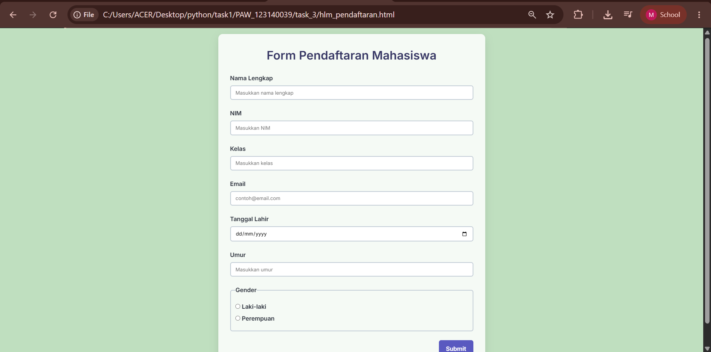
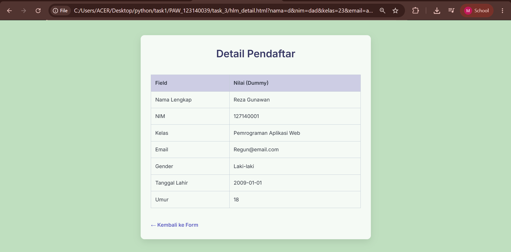

# Task 3 – Form Pendaftaran Mahasiswa

## Identitas Saya
- **Nama:** Muhammad Dzaky
- **NIM:** 123140039
- **Kelas:** 14-039-MuhammadDzaky

## Deskripsi Tugas
Buat sebuah proyek web sederhana **tanpa framework** yang menampilkan formulir pendaftaran mahasiswa dan halaman detail. Formulir mengirim data menggunakan metode **GET** sehingga nilai‑nilai dari form muncul sebagai query string pada URL halaman detail.

## Isi Folder `task_3`
| File | Kegunaan |
|------|----------|
| `hlm_pendaftaran.html` | Formulir pendaftaran (Nama, NIM, Kelas, Email, Tanggal Lahir, Umur, Gender) dengan tombol submit yang memiliki efek hover. |
| `hlm_detail.html` | Halaman menampilkan data pendaftar dalam tabel dummy yang mencerminkan semua field pada formulir. |
| `style.css` | Styling modern (glass‑morphism, flex‑grid layout, tiga tipe selector, hover efek, background hijau 25 % opacity). |
| `README.md` | Dokumentasi proyek (ini). |
| `hlm_pendaftaran.png` | Screenshot formulir pendaftaran. |
| `hlm_detail.png` | Screenshot halaman detail. |

## Bukti Dokumentasi
### Formulir Pendaftaran (`hlm_pendaftaran.html`)

### Halaman Detail (`hlm_detail.html`)

